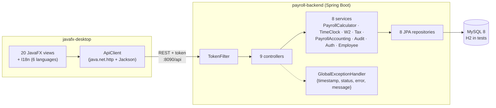
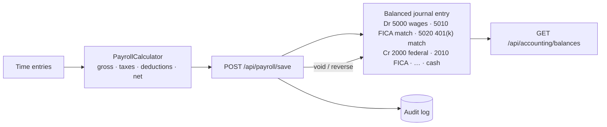

<div align="center">

# 💼 RbcTcsWorld EPMS — Enterprise Payroll Management System

### Spring Boot payroll REST API + native JavaFX desktop client — payroll math, time clock, W-2, YTD tax, double-entry GL — tested from unit to headless UI

[](https://git.io/typing-svg)

<!-- ============ STATUS BAR ============ -->
[](https://github.com/rbchy/RbcTcsWorld-EPMS/actions/workflows/ci.yml)


</div>

---

## 📌 At a Glance

<table>
<tr>
<td width="50%" valign="top">

**🙋 What this is**

A payroll platform built from scratch, together with the tests that keep it honest. It has two parts:

- **`payroll-backend`**: a Spring Boot REST API for employees, payroll calculation and payslips, time clock, W-2s, year-to-date tax, a double-entry general ledger, an audit log, BCrypt login with tokens, and a health check
- **`javafx-desktop`**: a native JavaFX client for that API, with login, dashboard, employees, payroll, time clock, payslips, reports, W-2, the ledger, the audit log, settings and help in **6 languages**

Most QA portfolio projects test a system someone else built. EPMS shows the other half of the job: **building the system and designing the tests for every layer of it.**

Every push runs all 79 tests in **GitHub Actions**, including the JavaFX UI tests, headless through Monocle with no virtual display.

</td>
<td width="50%" valign="top">

**📍 Quick facts**

| | |
|---|---|
| 🧩 **API** | 9 controllers · 27 endpoints · port 8090 |
| 🖥️ **Desktop** | 20 JavaFX screens · EN / বাংলা / ES / हिन्दी / FR / 中文 |
| 🧪 **Tests** | 67 backend · 12 desktop UI |
| ✅ **CI** | 79 / 79 · JDK 21 · ≈ 1.5 min |
| 🔐 **Security** | BCrypt passwords · token filter on `/api/*` |
| 📊 **Reports** | Allure HTML · JUnit summary in the run |

</td>
</tr>
</table>

---

## ✅ Latest Results

| Layer | Tests | What is asserted | Result |
|---|---:|---|---|
| 🧮 Payroll math (`PayrollCalculatorTest`) | 4 | A reference paystub, line for line: gross, taxable wages, federal / SS / Medicare / PA / local / LST / SUI, health, 401(k), Roth, catch-ups, employer match, net · gross = sum of earnings · net = gross − every deduction |  |
| 🔐 Security (`TokenServiceTest`) | 4 | A token resolves to its user · every token is unique · unknown and revoked tokens resolve to nobody |  |
| 🧩 Services, Mockito (7 classes) | 30 | Clock-in / clock-out state machine · payroll void / reverse rules · W-2 and YTD aggregation · balanced journal entries · login failure paths |  |
| 🌐 API, MockMvc + H2 (9 classes) | 29 | Real Spring context, JPA and SQL · 200 / 201 / 400 / 401 / 404 / 409 from the global error handler · seeded chart of accounts · journal per saved payroll |  |
| 🖥️ JavaFX UI, TestFX + Monocle (5 classes) | 12 | Valid and invalid login · dashboard navigation · employee table, add and required-field alert · calculate enables *Save Payslip* · clock-in, and the error alert when history fails to load |  |
| **Total** | **79** | | **100 %** |

<sub>GitHub Actions, Ubuntu, Temurin 21 ([workflow](.github/workflows/ci.yml)). Tests are tagged `@Tag("positive")` / `@Tag("negative")`. The Allure report and raw results are kept as build artifacts.</sub>

---

## 🏗️ Architecture



### Payroll → general ledger



---

## 🧩 API

| Domain | Endpoints |
|---|---|
| 🔐 Auth | `POST /api/auth/login` |
| 👤 Employees | `GET/POST /api/employees` · `GET/PUT/DELETE /api/employees/{id}` · `PATCH /api/employees/{id}/status` |
| 💵 Payroll | `POST /api/payroll/calculate` · `POST /api/payroll/save` · `GET /api/payroll` · `GET /api/payroll/employee/{id}` · `PATCH …/status` · `…/void` · `…/reverse` |
| ⏱️ Time clock | `POST /api/time-entries/clock-in` · `POST /api/time-entries/{id}/clock-out` · `GET /api/time-entries` · `GET /api/time-entries/employee/{id}` |
| 🧾 W-2 · Tax | `GET /api/w2/{employeeId}/{year}` · `GET /api/w2/year/{year}` · `GET /api/tax/ytd/{employeeId}` · `GET /api/tax/ytd-all` |
| 📒 Accounting | `GET /api/accounting/journal` · `GET /api/accounting/balances` |
| 🧾 Audit · Health | `GET /api/audit` · `GET /api/audit/entity` · `GET /api/health` |

Every failure that should be a 4xx is returned as `{timestamp, status, error, message}` instead of a raw 500:

| Status | When |
|---|---|
| **404** | Unknown resource |
| **409** | A business-rule conflict, such as a double clock-in or voiding a processed payroll |
| **401** | Bad credentials |
| **400** | Invalid input |

---

## 🛠️ Tech Stack

| Layer | Technology | Version |
|---|---|---|
| Language | Java (enforced with `maven-toolchains-plugin`) | 21 |
| Backend | Spring Boot (Web, Data JPA, Validation) · Hibernate · spring-security-crypto | 3.5.5 |
| Database | MySQL · H2 for the `test` profile | 8 |
| Desktop | JavaFX · Jackson · `java.net.http` | 21.0.8 |
| Unit / service tests | JUnit 5 · Mockito | — |
| API tests | Spring MockMvc on H2 | — |
| UI tests | TestFX + Monocle (headless) | 4.0.18 · 21.0.2 |
| Reporting | Allure + AspectJ · `mikepenz/action-junit-report` | 2.35 |
| Packaging | `jpackage` (see `scripts/package-windows.ps1`) | — |

---

## 📁 Project Structure

```
RbcTcsWorld-EPMS/
├── .github/workflows/ci.yml       ← backend tests → desktop UI tests (headless) → Allure
├── payroll-backend/
│   ├── src/main/java/com/epms/payroll/
│   │   ├── controller/            9 REST controllers
│   │   ├── service/               PayrollCalculator + 8 services
│   │   ├── repository/ entity/ dto/
│   │   ├── security/              TokenService, TokenFilter
│   │   ├── exception/             GlobalExceptionHandler + typed exceptions
│   │   └── config/                DataInitializer (admin, demo data, chart of accounts)
│   └── src/test/java/…            PayrollCalculatorTest · security/ · service/ · integration/
├── javafx-desktop/
│   ├── src/main/java/com/epms/desktop/   MainApp · ApiClient · I18n · ui/ (20 views)
│   └── src/test/java/…/ui/              5 TestFX test classes
├── database/schema.sql · sample-api.json
├── scripts/package-windows.ps1
└── pom.xml                        ← parent (two modules)
```

---

## ⚙️ Getting Started

**Prerequisites:** JDK 21 · Maven 3.9+ · MySQL 8

```bash
git clone https://github.com/rbchy/RbcTcsWorld-EPMS.git
cd RbcTcsWorld-EPMS

mvn clean test                                   # all 79 tests (H2 + headless UI, no MySQL needed)

mysql -u root -p < database/schema.sql
export DB_USERNAME=root DB_PASSWORD='your-mysql-password'
mvn -pl payroll-backend spring-boot:run          # http://localhost:8090/api/health
mvn -pl javafx-desktop javafx:run                # desktop client
```

On first start the backend seeds the user `admin` / `admin123`. **Change it before any real use.**

| Report | How |
|---|---|
| Allure, one module | `mvn -pl payroll-backend io.qameta.allure:allure-maven:2.15.0:serve` |
| Allure, both modules | copy both `target/allure-results` folders into one, then `allure serve` it |
| Desktop installer | `mvn -pl javafx-desktop clean package`, then `scripts/package-windows.ps1` |

---

## 🔄 How It Compares to a Pure Test-Automation Project

| | **EPMS (this repo)** | **[OrangeHRM Payroll Automation](https://github.com/rbchy/OrangeHRM_TestAutomation_TestNG_Junit5)** |
|---|---|---|
| System under test | Built from scratch here: Spring Boot, MySQL and JavaFX | An existing third-party HRM demo, plus a stubbed payroll API |
| Shows | Full-stack delivery and the test strategy for it | Black-box automation of a system you do not own |
| UI automation | JavaFX through TestFX / Monocle, headless | Web UI through Selenium / Cucumber |
| API testing | MockMvc against the real controllers, services and JPA | REST Assured against real HTTP endpoints, with WireMock |
| Stack | Java 21 · JUnit 5 · Mockito · TestFX | JUnit 5 · TestNG · REST Assured · WireMock |

---

## 🧹 Maintenance Log

| Change | Why |
|---|---|
| **Added the source code:** `payroll-backend`, `javafx-desktop`, all 79 tests and the CI workflow | The GitHub repo held only the README, the parent `pom.xml` and the SQL script. The two modules the README described were never pushed, so nothing could be built from GitHub |
| MySQL password removed from `application.properties`; now `DB_PASSWORD` (plus `DB_USERNAME` / `DB_HOST`) | A real database password was in the config file |
| `TimeClockViewTest` waits for the alert's content and closes it by `ButtonType.OK` | The test clicked a node labelled "OK" before the dialog was laid out, which failed on the CI runner. It now also checks the alert shows the API's error |
| CI runs on every branch push; the badge points at this repo | It ran only on `main` / `master`, and the badge pointed at a different repo name |
| `.gitignore` for `target/`, IDE files and AspectJ `ajcore` dumps | Build output was not ignored |
| README corrected | The API port is **8090**, not 8080. The desktop has 20 screens, not 5. The CI badge now points at the real repo |

---

## 📈 Roadmap

- [x] Source on GitHub, CI green for both modules
- [ ] IRS / W-4 table-based federal withholding (the current flat rate is a demo stand-in)
- [ ] Role-based authorization per endpoint (ADMIN / HR / EMPLOYEE)
- [ ] Testcontainers MySQL for repository tests
- [ ] TestFX coverage for the W-2, report and ledger screens
- [ ] Publish the combined Allure report to GitHub Pages
- [ ] macOS / Linux `jpackage` installers in CI

---

## 🔗 Related Projects

| Project | Stack |
|---|---|
| 🧾 [OrangeHRM Payroll Automation](https://github.com/rbchy/OrangeHRM_TestAutomation_TestNG_Junit5) | JUnit 5 · TestNG · REST Assured · WireMock — 66 / 66 in CI |
| 💊 [PharmaPack QMS — Serialization & Line Control](https://github.com/rbchy/RbcTcsWorld_PharmaPackQMS_Serialization) | Spring Boot · React · L3 serialization — 77 / 77 in CI |
| 🧮 [Pharmaceutical Production Calculator](https://github.com/rbchy/RbcTcsWorld_Pharmaceuticals_PMC) | Spring Boot · MySQL · Selenium — 81 / 81 in CI |
| ⭐ [RbcTcsWorld E-Commerce Suite](https://github.com/rbchy/RbcTcsWorld_ECommerceSuite) | Spring Boot · REST Assured · Selenium · Playwright · CI quality gates |

<sub>All projects: [github.com/rbchy](https://github.com/rbchy)</sub>

---

## ⚠️ Disclaimer

This is a personal portfolio / demonstration project. It is **not** for real payroll as-is: federal withholding uses a flat demo rate instead of the IRS / W-4 tables, and the seeded admin password is public.

---

## 👤 Author

<div align="center">

**Ranajit Baran Chowdhury (RB Chowdhury)**
QA Automation Engineer / SDET · Full-Stack Developer · West Norriton, Pennsylvania, USA

[](https://www.linkedin.com/in/rbchy/)
[](https://github.com/rbchy)
[](https://rbchy.github.io/rbchy/)
[](https://rbc6543.wixsite.com/rbc-portfolio)
[](mailto:chyranajit@gmail.com)

⭐ *If this project helps you, a star on the repo is appreciated.*

</div>
